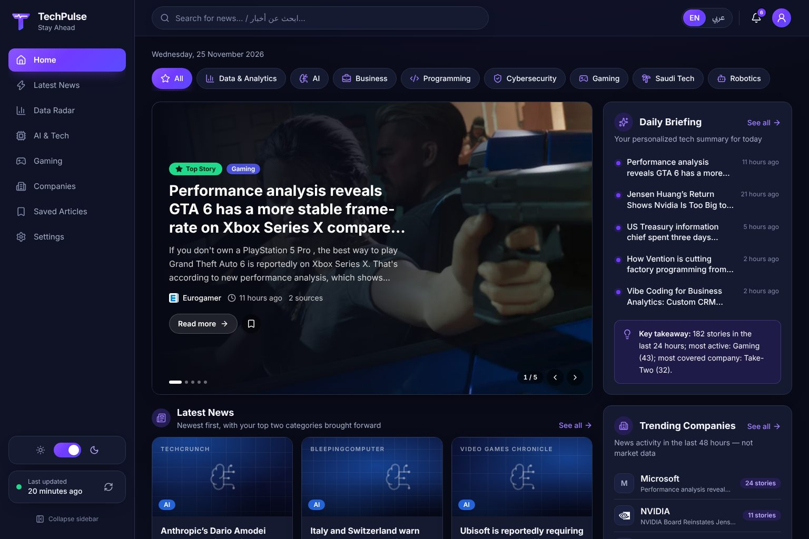
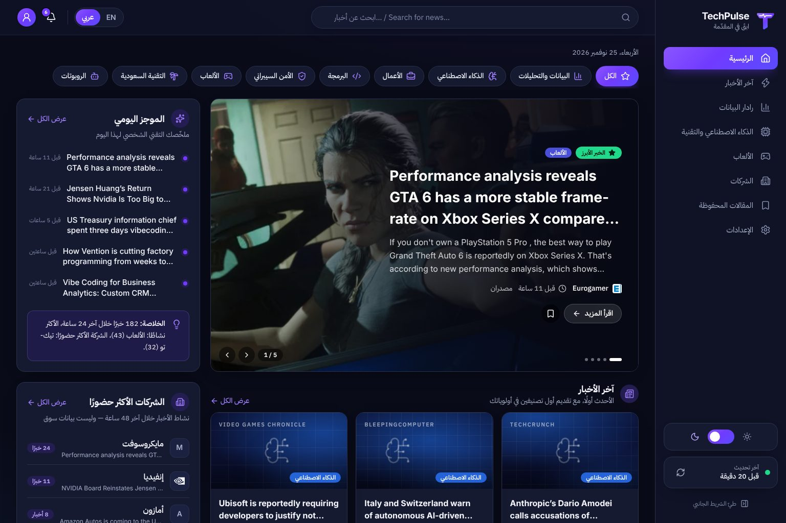
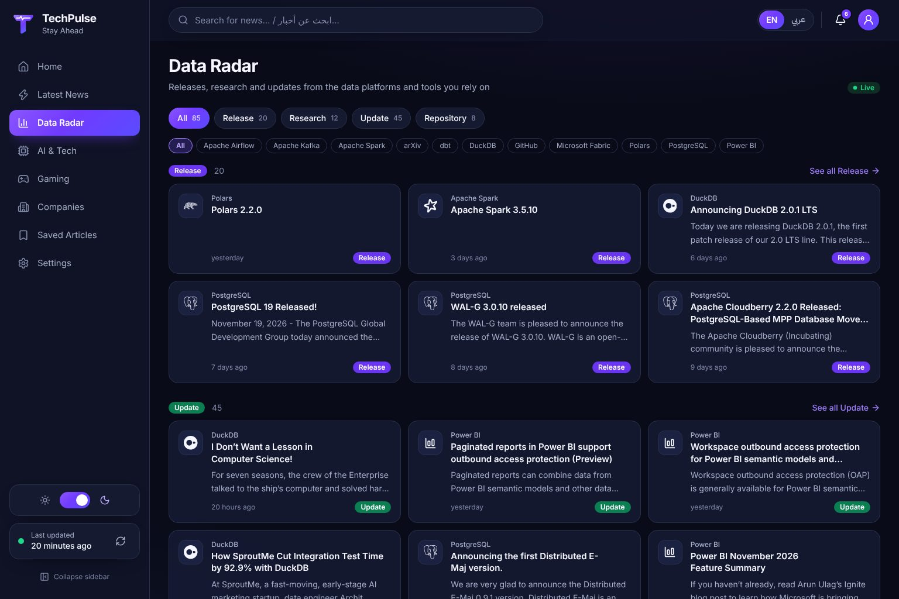
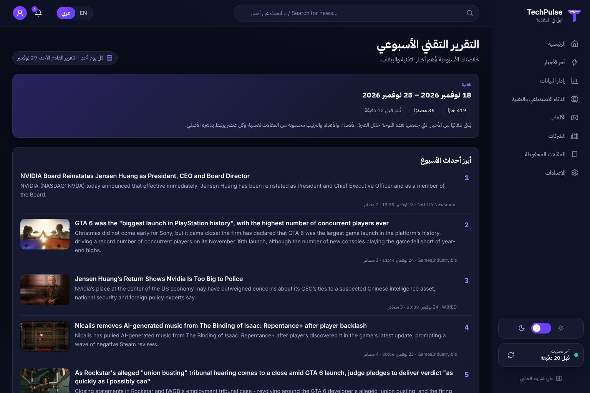
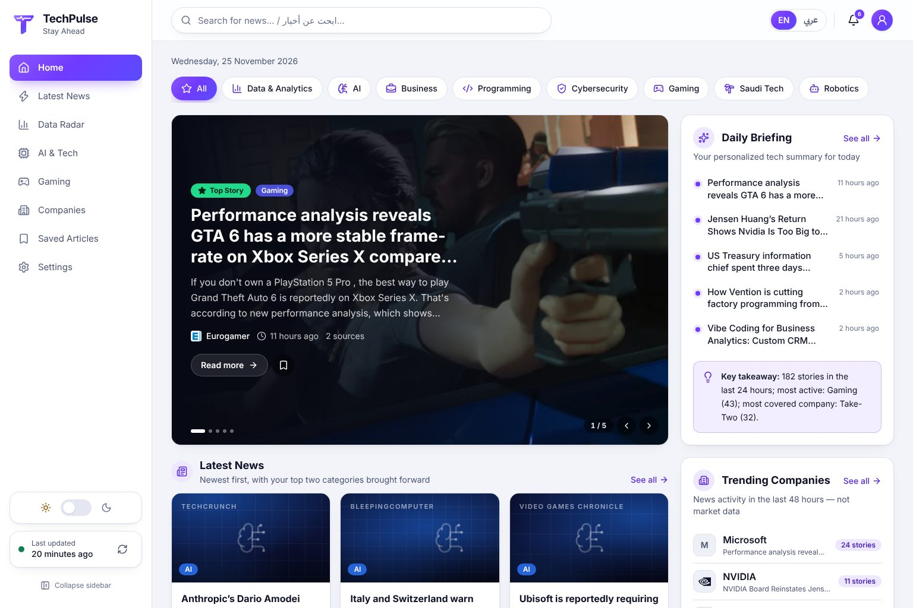
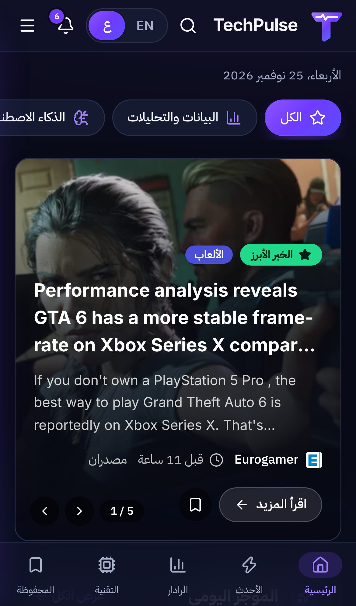

# TechPulse · Stay Ahead

A personal, bilingual (Arabic / English) technology, data and gaming news dashboard. It collects news from reputable publishers and official company newsrooms, removes duplicates and noise, groups coverage of the same event into one story, ranks stories by importance, and summarizes them in English and Arabic. A **Data Radar** follows releases, research and updates from data platforms, and a **Weekly Tech Report** is published every Sunday.

It is built to answer, in one screen:

- What happened in technology today?
- What are the biggest developments in gaming?
- What are NVIDIA, AMD, Microsoft, Apple, Google and the other major companies doing?
- Which announcements matter?
- Which important stories did I miss?

| English (dark) | Arabic (dark, RTL) |
| --- | --- |
|  |  |
|  |  |
|  |  |

> The screenshots show real articles, releases and papers fetched on 25 Nov 2026 **without** an AI key configured. In that mode cards show the publisher's own excerpt and headlines stay in their original language. See [AI summaries](#ai-summaries--translation). Stories whose publisher supplies no image get abstract category artwork, never a stand-in photo.

---

## Web edition — open it, nothing to install

**<https://shabebalthori.github.io/news-dashboard/>**

The web edition is a free, always-on copy of the dashboard hosted on GitHub Pages. Open it on a phone or a computer; there is nothing to install or run.

- **Automatic updates.** A GitHub Actions workflow ([`.github/workflows/web-edition.yml`](.github/workflows/web-edition.yml)) runs about every 15 minutes, even when your computer is off. Each run fetches the feeds, deduplicates, clusters, scores and (optionally) summarizes the news, then publishes the result. GitHub sometimes starts scheduled runs a few minutes late.
- **Same features.** All pages, filters, search, Arabic/English, themes, importance ranking, the Data Radar and the Weekly Tech Report work as in the self-hosted version. Ranking and search run in your browser over the latest published data (the last 7 days). The radar's **Live** label reflects the last successful scheduled run, so it switches off by itself if GitHub delays the schedule.
- **Your data stays in your browser.** Saved stories, read history (used by "You might have missed") and settings are kept in the browser's storage on each device, not on GitHub.
- **AI summaries and Arabic translation (free option).**
  1. Create a free Gemini API key at <https://aistudio.google.com/apikey> (sign in with a Google account, then **Create API key**).
  2. On GitHub, open **Settings → Secrets and variables → Actions → New repository secret** and add it as `GEMINI_API_KEY`.

  The next run starts summarizing. Alternatively add `ANTHROPIC_API_KEY` for Claude (paid; used first if both are set). Without a key, the page shows the publishers' own excerpts.
- **Visibility.** GitHub Pages sites from free accounts are public, so anyone with the link can open the page. It asks search engines not to index it. No keys or passwords are ever published.
- **Manual update.** Open the **Actions** tab → **Web edition** → **Run workflow**.
- **Schedule pauses.** GitHub pauses schedules after 60 days without repository activity. The workflow makes an empty commit when needed to keep it running.

To build the web edition yourself:

```bash
BASE_PATH=/news-dashboard npm run build:static
```

```bash
npm run export:static
```

The first command writes the site to `out/`; the second refreshes feeds and writes `out/data/` (`snapshot.json`, `status.json`, `radar.json`, `report.json`).

---

## Contents

1. [Quick start](#quick-start)
2. [Web edition](#web-edition--open-it-nothing-to-install)
3. [Features](#features)
4. [How it works](#how-it-works)
5. [AI summaries & translation](#ai-summaries--translation) — why a key is needed, costs, free alternatives
6. [Sources and compliance](#sources-and-compliance)
7. [Configuration](#configuration)
8. [Deployment](#deployment)
9. [Testing](#testing)
10. [Project structure](#project-structure)
11. [Troubleshooting](#troubleshooting)

---

## Quick start

Requirements: **Node.js 20.9+** (22 LTS recommended) and npm. No external database is needed; SQLite is embedded.

```bash
npm install
```

```bash
cp .env.example .env.local
```

Optionally put your Claude API key in `.env.local` (`ANTHROPIC_API_KEY=...`). Then:

```bash
npm run dev
```

Open <http://localhost:3000>. The first refresh starts about 5 seconds after the server boots and takes 5–15 seconds; after that feeds refresh automatically every 12 minutes (10–15, configurable).

To fetch on demand from the command line:

```bash
npm run refresh
```

For production:

```bash
npm run build
```

```bash
npm start
```

---

## Features

**Your categories, in priority order**

1. Data Science & Analytics
2. AI & Artificial Intelligence
3. Business & Financial Results
4. Programming & Open Source
5. Cybersecurity & Hacking
6. PC Hardware & Gaming
7. Saudi Technology & Startups
8. Robotics

- **Ranking:** a story ranks higher the higher its category is in your list. Change the order (up/down) or switch categories off in **Settings → Your categories**; nothing is ever hidden.
- **Dashboard and filters:** the dashboard's **Your categories** section and the category chips follow your order.
- **Sub-topics:** each category groups the detailed topics underneath it (for example, consoles, releases and game engines under *PC Hardware & Gaming*; earnings, acquisitions, layoffs and leadership under *Business & Financial Results*).
- **More topics:** software, phones and operating systems stay available as extra topics ranked below the eight.
- **Upgrading:** settings, saved stories and stored articles from earlier versions carry over. Old topic choices map to the new categories, and stored stories are re-tagged once for the new categories (additive only).

**Content**
- 41 legitimate RSS/Atom feeds: Ars Technica, The Verge (+ Gaming), TechCrunch, WIRED, Engadget, MIT Technology Review, Tom's Hardware, BleepingComputer, The Record, IGN, PC Gamer, GameSpot, Eurogamer, Rock Paper Shotgun, GamesIndustry.biz, VGC, and official newsrooms of NVIDIA, AMD, Microsoft, Google, Apple, OpenAI, Meta, Amazon, Samsung, PlayStation, Xbox, Steam, Unreal Engine and GitHub.
  - **Data science:** SiliconANGLE (Data), KDnuggets and Towards Data Science. The last two are tutorial-heavy, so they get lower credibility and how-to posts are filtered.
  - **Robotics:** The Robot Report, IEEE Spectrum Robotics and TechCrunch Robotics.
  - **Saudi technology and startups:** Wamda, TechCrunch's Saudi Arabia feed, and two Saudi-based Arabic sites, البوابة التقنية (AIT News) and عالم التقنية (Tech-WD).
- **Arabic-language sources** are classified with Arabic keyword rules (categories, companies, events, and the same excluded topics) and shown in Arabic. Until an AI provider translates them, English readers see the original Arabic with a note.
- Categories: AI, software, cybersecurity, PC hardware & GPUs, CPUs & semiconductors, phones & consumer electronics, operating systems, programming; PC gaming, PlayStation/Xbox/Nintendo, releases, gaming industry, gaming hardware, Steam & platforms, game engines, esports business; earnings, acquisitions, partnerships, layoffs, leadership, strategy, product announcements.
- 27 tracked companies (the 18 you listed, Databricks, Snowflake and Palantir, plus TSMC, Arm, xAI, ByteDance, Epic Games and Ubisoft), with aliases such as Xbox → Microsoft, GeForce → NVIDIA, Rockstar/GTA → Take-Two.
- **Strict exclusion** of politics and elections, political conflicts, sports (but not sports video games), esports match results, celebrity gossip, film/TV/music entertainment, shopping deals and coupons, how-to guides and walkthroughs, puzzle answers, podcasts/roundups, sponsored posts and clickbait. On the first real fetch, 174 of 571 items were filtered out this way (65 deals, 54 off-topic, 24 guides, 16 politics, 11 entertainment and a few others).

**Dashboard (TechPulse design)**
- **Category chips:** All · Data & Analytics · AI · Business · Programming · Cybersecurity · Gaming · Saudi Tech · Robotics. A chip filters the whole dashboard (`/?cat=…`).
- **Featured Top Story** carousel: the five most important stories, using the publisher's own image (abstract category artwork when there is none), with source, publication time, Read more and bookmark.
- **Daily Briefing:** the leading story of each of your priority categories in the last 24 hours, plus a *key takeaway* that is counted, not written: number of stories, most active category and most covered company.
- **Latest News** grid: newest first, with your two highest-priority categories (by default Data & Analytics and AI) brought forward. Stories without a publication time are not treated as brand new, and no publisher fills more than two cards.
- **Trending Companies:** NVIDIA, Microsoft, Google, Apple, Amazon, AMD, Intel, OpenAI, Anthropic, Databricks, Snowflake and Palantir, ranked by **news activity** (stories in 48 hours) with their latest headline. **No stock prices or percentage changes are shown**; the dashboard has no verified market-data source.
- **Data Radar** panel and **Weekly Tech Report** panel (below), then Your categories, Key announcements, You might have missed, Technology today and Biggest in gaming.

**Data Radar** (`/radar`)
- Releases, research, product updates and notable new repositories from data platforms: PostgreSQL, Apache Spark, Apache Kafka, Apache Airflow, DuckDB, dbt, Polars, Apache Iceberg, Microsoft Fabric, Power BI, arXiv (Databases) and GitHub.
- Each item shows the project, title, the source's own publication date, a type badge (Release, Research, Update, Repository) and links to the original.
- Pre-releases (rc, beta, dev builds), arXiv revisions and community events (calls for papers, meetups) are left out.
- The green **Live** label appears only when the radar refreshed successfully in the last 40 minutes; otherwise the panel says when it last refreshed.

**Weekly Tech Report** (`/report`)
- Published every Sunday at 02:00 UTC (05:00 Riyadh), and straight away when none exists yet. It covers the 7 days before publication.
- Assembled from the stories collected during the week: highlights (at most two per category), one section per priority category, major-company activity, and the week's data-platform releases. Counts and rankings are computed; every entry keeps its publisher's headline, summary, link and publication time. No AI prose is added.
- Earlier reports stay available (the last 12 on a server, the last 6 in the web edition).

**Reading experience**
- Pages: Home, Latest News, Data Radar, AI & Tech, Gaming, Companies (logos, grid and per-company feed), Saved Articles, Settings, plus Search and the Weekly Report.
- Top bar: bilingual search (Arabic or English), an EN | عربي switch, notifications (breaking and major stories of the last 24 hours, with an unread count) and a profile menu. There are no accounts: the menu explains where your settings and saved articles are kept.
- Each card shows: headline (with the original headline whenever a translated or cleaned-up one is shown), a 2–4 sentence summary, category, source (official sources marked), **publication time** (absolute and relative), number of independent sources, an importance indicator, links to other coverage, a "Why it ranks here" breakdown, and the **retrieval time**. Each card can be flipped to its other-language version.
- Filters: category, company, date (today, 24 h, 3/7/30 days, any time, custom range), sort by importance or newest, and "Group same story" on/off. Filters live in the URL, so switching language never loses the current page or filters.
- Search in English or Arabic (full-text, prefix matching; Arabic company names and key terms also match English text).
- Arabic is first-class: server-rendered `dir="rtl"` with no flash, IBM Plex Sans Arabic with generous line height, logical CSS properties throughout, Arabic plural rules, Western digits, isolated English fragments inside Arabic text.
- **Design:** a dark premium theme by default (background `#090B18`, violet `#713BFF` and blue `#4388FF` accents, success green `#20D98A`) with a matching light theme and an optional "system" setting. Glass is used only for floating chrome (top bar, bottom tabs). Motion is restrained: card lift on hover, shimmering loading skeletons, and nothing when the system asks for reduced motion.
- **Layout:** full sidebar on desktop (collapsible), an icon rail on tablets, and a compact top bar, single column, bottom tabs and a menu drawer on phones. In Arabic the whole layout mirrors.
- **Logos:** company and project marks come from [Simple Icons](https://simpleicons.org) (CC0). Brands that are not there (Microsoft, Amazon, OpenAI, Nintendo and others) get a plain monogram. Publisher icons are the sites' own favicons.

**Reliability**
- Automatic refresh every 10–15 minutes (in-process scheduler with a database lock; optional standalone worker or external cron).
- Last successful update time is always visible; failing sources are listed and their previously retrieved articles stay available.
- Conditional requests (ETag / Last-Modified), timeouts, response size limits, exponential backoff and `Retry-After` handling.
- Duplicate removal by canonical URL (tracking parameters stripped) and by feed GUID.

---

## How it works

```
 RSS/Atom feeds ─► fetch (robots.txt, conditional GET, backoff)
                 ─► parse (RSS 2.0 / Atom / RDF) ─► clean text
                 ─► dedupe (canonical URL, GUID)
                 ─► classify (exclusions, categories, companies, event type, significance)
                 ─► cluster (same event across outlets)
                 ─► score (importance 0–100) ─► AI summary + Arabic translation (optional)
                 ─► SQLite ─► JSON API ─► Next.js UI (SWR, auto-refresh)
```

### Importance score (0–100)

| Component | Weight | What it measures |
| --- | --- | --- |
| Significance | 35 | Event type: acquisitions, CEO changes, layoffs, earnings and major security incidents rank above launches, which rank above updates; reviews and opinion rank lowest. Dollar amounts, flagship products and top-tier companies raise it; rumours and clickbait lower it. If AI is enabled, its 1–5 rating is blended in (50/50). |
| Independent coverage | 20 | Distinct publishers covering the event (The Verge and The Verge Gaming count once). 1 → 0, 2 → 0.45, 3 → 0.7, 4 → 0.85, 5+ → 1. |
| Credibility | 15 | Best editorial reliability weight among the sources in the cluster. |
| Industry impact | 15 | Tier of the companies involved, plus high-impact sectors (AI, chips, security, corporate events). |
| Relevance | 15 | Match with the categories and companies you choose in Settings. |
| Penalties | − | Rumour (−6), review/opinion (−12), clickbait signals (up to −8), headline-only (−2). |

Tiers: **Major** ≥ 72 · **Notable** ≥ 55 · **Standard** ≥ 38 · **Minor** below that.

**Breaking** is deliberately rare. A story is labelled breaking only if it was first published within the last 6 hours, is reported by at least 3 independent publishers, is not a rumour, has significance ≥ 0.7 and has an overall score ≥ 72.

### Story clustering

Headlines are tokenized (stop words removed, inflections normalized, `GPT-5` → `gpt5`), weighted by rarity across recent articles, and compared with a weighted Dice similarity. Articles within 36 hours of each other whose similarity reaches 0.42, and which share at least one rare word, join the same story. The most credible article with real text becomes the lead; the others appear under "Other coverage". In the first real run, NVIDIA's reinstatement of Jensen Huang grouped 7 articles from 7 independent outlets, including NVIDIA's own newsroom, while separate GTA 6 stories (patch, PC port, sales) stayed separate.

### Publication time vs. retrieval time

- **Published**: the time the publisher states in its feed. If a feed gives no date, or an implausible future date, the card says "Publication time not provided by the source". Dates are never invented.
- **Retrieved**: when this dashboard first fetched the article. It is shown separately on every card.

---

## AI summaries & translation

### Why an API key is needed

Feeds give an English headline and usually a short excerpt. Producing natural Arabic headlines and summaries, plus a consistent 2–4 sentence English summary, needs a language model. Without one the app still works fully, with these differences:

- English cards show the publisher's own excerpt, labelled "Excerpt from the publisher" (copied word for word, never rewritten).
- Arabic readers get the full Arabic interface, but the story text is the source's English, with a short note explaining that the Arabic summary is not available yet.

### Options

| Option | Cost | Arabic quality | Setup |
| --- | --- | --- | --- |
| **Claude (default)** | Paid per use | Natural, idiomatic Arabic | `ANTHROPIC_API_KEY=...` |
| **Google Gemini (free tier)** | Free, within Google's daily limits | Good | Free key from [aistudio.google.com/apikey](https://aistudio.google.com/apikey), then `GEMINI_API_KEY=...` (or the GitHub secret of the same name) |
| **Ollama (free)** | Free; runs on your own machine | Depends on the model (Qwen 2.5 7B and larger handle Arabic reasonably; smaller models are weaker) | Install [Ollama](https://ollama.com), `ollama pull qwen2.5:7b-instruct`, set `AI_PROVIDER=ollama` |
| **No AI** | Free | No Arabic summaries | Default when no key is set |

**About the Gemini free tier:** Google lists `gemini-3.8-flash` and `gemini-3.5-flash-lite` as free of charge on the free tier, within per-minute and per-day request limits shown in AI Studio. The app spaces requests about 6.5 seconds apart, retries once when a model is busy ("high demand"), then tries the other free models in turn (`gemini-3.6-flash`, then the lighter `gemini-3.5-flash-lite` and `gemini-3.1-flash-lite`, whose Arabic is weaker), and shows publisher excerpts for anything left unsummarized. Google states that free-tier requests may be used to improve its products; here they contain only public news text from the feeds.

### Costs (Claude)

The default model is `claude-opus-5-5`, used at `low` effort. Each story lead is summarized once, and only story leads are summarized, not every duplicate article. As a rough estimate, each summary uses about 2–3k input tokens and about 1k output tokens. That is roughly **$0.03 per story** on Opus 5.5 and roughly **$0.001 per story** on Claude Haiku 5.5. A typical day produces something like 100–200 new stories, which is about $3–6 per day on Opus 5.5 or a few cents per day on Haiku.

These are estimates; check actual usage in the Anthropic Console. Built-in guards:

- `AI_MAX_ARTICLES_PER_RUN=30` limits each refresh.
- `AI_DAILY_LIMIT=200` caps any 24-hour period.
- The most important stories are summarized first.
- Only stories from the last 3 days are summarized.

To use the cheaper model, set `ANTHROPIC_MODEL=claude-haiku-5-5`. That choice is yours: Opus writes stronger Arabic and is the default.

### Accuracy safeguards

- The model sees only the text the publisher makes available in its feed. Articles are never scraped, and paywalled pages are never fetched.
- The system prompt forbids adding facts, requires that rumours, estimates and leaks stay hedged in both languages ("reportedly", «بحسب تقارير»), and treats article text as untrusted data, never as instructions.
- Output must match a strict JSON schema, which the API enforces through structured outputs and the app checks again with Zod.
- **Number check:** every number in the generated headlines and summaries (English and Arabic, including Arabic-Indic digits) must appear in the source text. If any number does not, the summary is discarded and the publisher's excerpt is shown instead.
- Stories the model identifies as politics, sports, entertainment, celebrity news, deals or clickbait are excluded, together with the other articles in the same story.
- Refusals are handled: with Opus 5.5 the request includes server-side refusal fallbacks (`ANTHROPIC_FALLBACKS=default`); a refused story keeps its publisher excerpt.
- Publishers whose robots.txt sets `Content-Signal: ai-input=no` are never sent to a model; their stories show the excerpt only.

> **Testing note:** the Claude integration was tested with the real Anthropic SDK against a local mock of the API. The tests cover the request shape, structured output, effort, refusal fallbacks, refusal and auth errors, and the full pipeline. No real API key was available while building this, so the quality of real Arabic summaries has not been reviewed yet. Check a handful of stories after you add your key.

---

## Sources and compliance

- Only feeds the publishers offer for syndication are used; there is no HTML scraping.
- `robots.txt` is checked per host (cached for 24 hours) using the fetcher's own product token (`PersonalNewsDashboard`). A disallowed feed is skipped and shown as "Blocked by robots.txt" in Settings.
- Each feed is requested at most once per refresh, with conditional requests. On the second refresh, 20 of 31 feeds answered `304 Not Modified`.
- Every card links to the original article; the dashboard keeps the original headline.

**Deliberately not included:**

| Source | Why |
| --- | --- |
| Reuters Technology | Reuters has offered no public RSS since 2020, and reuters.com's robots.txt disallows automated access. The legitimate route is a paid Reuters licence (Reuters Connect / API). Google News RSS is not a substitute: news.google.com's robots.txt disallows `/rss`. |
| The Register | Its robots.txt denies unlisted crawlers by default and requires a licence for AI use. |
| Unity Blog | unity.com's robots.txt disallows `/blog/rss`. |
| Snowflake Blog | snowflake.com's robots.txt disallows `/feed/`. |
| InfoWorld | Its robots.txt disallows the feed for unlisted crawlers. |
| Nintendo, EA, Take-Two, Valve corporate, Qualcomm, Tencent, Anthropic | No public news feed was found. These companies are still covered through the publishers above (and Steam News for Valve). |

To add a source, append it to `src/lib/server/sources.ts`. Sources can be switched off in Settings.

**Data Radar sources** (`src/lib/server/radar.ts`) are fetched with the same polite fetcher (robots.txt, conditional requests, backoff). Slow-moving sources are fetched less often (arXiv and Kafka every 6 hours, PyPI feeds every 1–2 hours).

| Platform | Source |
| --- | --- |
| PostgreSQL | postgresql.org news feed |
| Microsoft Fabric, Power BI | the official Microsoft blogs' feeds |
| Apache Kafka | the blog entries of kafka.apache.org's site feed |
| Apache Airflow, DuckDB | the projects' own blog feeds |
| Apache Spark, dbt Core, Polars, PyIceberg | PyPI's official per-project release feeds |
| Research | arXiv's official RSS for cs.DB (new papers only) |
| GitHub repositories | GitHub's REST search API — only when `GITHUB_TOKEN` is set (the web edition's workflow passes its built-in token). Notable new repositories tagged data-engineering or database, with at least 100 stars. |

Not used for the radar: github.com release/tag Atom feeds (their `robots.txt` status for automated clients could not be verified, so the documented API is used instead) and spark.apache.org (no feed; Spark releases come from PyPI).

---

## Configuration

All configuration is via environment variables (see [`.env.example`](.env.example)). Reader preferences are stored in the database and edited in **Settings**: interests, followed companies, reviews on/off, tech-policy news on/off, images, refresh interval and retention. Secrets are only read on the server and never sent to the browser.

| Variable | Default | Purpose |
| --- | --- | --- |
| `DATABASE_PATH` | `./data/news.db` | SQLite file |
| `REFRESH_INTERVAL_MINUTES` | `12` | Default interval, 10–15 |
| `DISABLE_SCHEDULER` | `false` | Turn off the in-process scheduler (use `npm run worker` or cron instead) |
| `CRON_SECRET` | — | Enables `POST /api/refresh` with `Authorization: Bearer <secret>` |
| `FETCH_CONTACT` | — | Contact URL/email appended to the User-Agent |
| `AI_PROVIDER` | auto | `anthropic`, `gemini`, `ollama` or `none` (auto: Claude if its key is set, else Gemini, else none) |
| `ANTHROPIC_API_KEY` | — | Claude API key |
| `ANTHROPIC_MODEL` | `claude-opus-5-5` | Model id |
| `ANTHROPIC_EFFORT` | `low` | `low`, `medium` or `high` |
| `ANTHROPIC_FALLBACKS` | `default` | Server-side refusal fallbacks (`off` to disable) |
| `GEMINI_API_KEY` | — | Google Gemini API key (free tier available) |
| `GEMINI_MODEL` / `GEMINI_FALLBACK_MODELS` | `gemini-3.8-flash` / `gemini-3.6-flash,gemini-3.5-flash-lite,gemini-3.1-flash-lite` | Gemini models; fallbacks are tried in order when the main model is busy or out of free quota |
| `OLLAMA_BASE_URL` / `OLLAMA_MODEL` | `http://localhost:11434` / `qwen2.5:7b-instruct` | Free local model |
| `AI_MAX_ARTICLES_PER_RUN` / `AI_DAILY_LIMIT` / `AI_CONCURRENCY` | `30` / `200` / `3` | Cost and throughput guards |
| `DASHBOARD_USER` / `DASHBOARD_PASSWORD` | — | HTTP Basic auth for the whole app when both are set |

---

## Deployment

The app needs a **long-running Node.js process with a persistent disk**, because of the SQLite file and the built-in scheduler. That makes it a good fit for Docker on a VPS or home server, Fly.io or Railway with a volume, or a Raspberry Pi. Serverless platforms such as Vercel are a poor fit because they have no persistent filesystem or background timers. If you need serverless, replace SQLite with a hosted database and call `/api/refresh` from a cron.

### Docker (recommended)

```bash
cp .env.example .env
```

Edit `.env` (at minimum set `DASHBOARD_USER`/`DASHBOARD_PASSWORD` if the server is reachable from the internet), then:

```bash
docker compose up -d --build
```

The image builds Next.js in standalone mode, runs as a non-root user, stores the database in the `briefing-data` volume at `/data`, and includes a health check. It was built and run successfully while developing this app (health: healthy; first refresh: 31 sources, 571 articles). Put it behind a reverse proxy with HTTPS (Caddy, nginx, Traefik).

### Plain Node.js (VPS, systemd or pm2)

```bash
npm ci
```

```bash
npm run build
```

```bash
NODE_ENV=production PORT=3000 npm start
```

Keep `data/` on persistent storage and back it up if you care about saved stories.

### External scheduler (optional)

Set `DISABLE_SCHEDULER=true` and `CRON_SECRET`, then trigger refreshes every 12 minutes:

```bash
curl -fsS -X POST -H "Authorization: Bearer $CRON_SECRET" https://your-host/api/refresh
```

Alternatively, run `npm run worker` as a separate process next to the web server.

### Security checklist

- Set `DASHBOARD_USER`/`DASHBOARD_PASSWORD` (or put the app behind your own auth) before exposing it, and always use HTTPS.
- State-changing endpoints reject cross-site requests; manual refreshes are rate-limited to one every 3 minutes.
- API keys live only in server environment variables.
- The site sends `X-Frame-Options`, `nosniff`, `Referrer-Policy` and `Permissions-Policy` headers and asks search engines not to index it.

---

## Testing

```bash
npm test
```

```bash
npm run typecheck
```

```bash
npm run lint
```

84 automated tests cover:

- feed parsing (RSS 2.0, Atom, RDF, missing dates)
- text cleanup (decimals, entities, tracking parameters)
- exclusion rules on real headlines
- categories, companies and events
- clustering
- scoring and the breaking rule
- the AI number check
- robots Content-Signal parsing
- search query building (including Arabic synonyms)
- Arabic plural forms
- the Claude, Gemini and Ollama clients against local mock servers
- the web edition's in-browser ranking, filters, Arabic search, saved stories and dashboard
- the priority categories: exact order, migration of older settings, priority-weighted ranking, category filters, the new topic rules, Arabic classification and exclusions, and the one-time re-tag of stored stories
- a full pipeline run with a mocked network (cross-feed deduplication, clustering, an outage that preserves articles, rejection of a summary with an invented number, AI exclusion, dashboard and search)

During development the app was also checked in a real browser (Playwright):

- every page in English and Arabic, light and dark, desktop and mobile
- no console errors and no horizontal overflow
- switching language keeps the URL and filters
- saving, coverage links, Arabic search, per-card language switching
- refresh rate limiting and cross-site request rejection

---

## Project structure

```
src/
  app/                    Pages (dashboard, latest, radar, report, technology, gaming, companies, search, saved,
                          settings) and API routes (stories, dashboard, radar, report, settings, …)
  components/             Client UI: app shell + top bar, dashboard (hero, briefing, news grid, trending
                          companies), radar and report views, story card, feed + filters, settings
  lib/shared/             Client-safe code: taxonomy, i18n (en/ar), formatting, types, scoring, search,
                          rank.ts (ranking + dashboard builder, shared by server and web edition),
                          schedule.ts (Live rule, report schedule), brand-marks.ts (Simple Icons, CC0)
  lib/client/             Web-edition data layer (static snapshot + browser storage) and shared actions
  lib/server/             Server-only code
    sources.ts            Feed registry (with reasons for exclusions)
    fetcher.ts robots.ts  Polite fetching
    feed-parser.ts text.ts
    classify.ts           Exclusion rules, categories, companies, events, significance
    cluster.ts scoring.ts Story grouping and importance
    ai/                   Claude + Ollama providers, prompt, fact guard
    pipeline.ts           Refresh pipeline; scheduler.ts runs it on a timer
    queries.ts            Story listing, dashboard, search
    radar.ts              Data Radar sources, parsing and storage
    report.ts             Weekly Tech Report (built every Sunday from stored stories)
  instrumentation.ts      Starts the scheduler with the server
  proxy.ts                Optional Basic auth
scripts/                  refresh.ts (one-off), worker.ts (standalone scheduler),
                          build-static.mjs + export-static.ts (web edition)
.github/workflows/        web-edition.yml (GitHub Pages, every ~15 minutes)
tests/                    Vitest suites
```

---

## Troubleshooting

- **No stories yet**: the first refresh runs about 5 seconds after boot. Check the sidebar status, or run `npm run refresh` and read its JSON output.
- **A source shows "Unavailable"**: the error is listed in Settings → Sources. The app retries with backoff, and that source's earlier articles stay visible.
- **Arabic summaries missing**: check Settings → Summaries & translation for the provider status and the last error. Without a provider, Arabic summaries are intentionally unavailable.
- **`better-sqlite3` build errors**: use Node 20.9+ on a platform with prebuilt binaries, or install a C++ toolchain (`python3 make g++`).
- **Behind a corporate HTTP proxy**: Node's built-in `fetch` ignores `HTTPS_PROXY` unless you set `NODE_USE_ENV_PROXY=1` (Node 22.21+).
